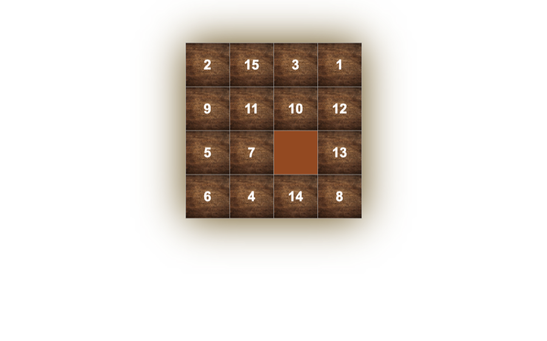

# 15 Puzzle

The classic sliding puzzle: arrange 15 tiles on a 4×4 board in order from 1 to 15.

**[Play online →](https://ceyhun1999.github.io/15-GAME-PUZZLE/)**

<p align="center"></p>

## How to play

1. The tiles start shuffled, with one empty cell on the board.
2. Click a tile next to the empty cell to slide it into the gap.
3. Put the numbers in order from 1 to 15.

Every move plays a sound.

## Project structure

```
├── index.htm
├── style.css
├── javascript.js   # board and move logic
├── img/            # tile texture
└── sound/          # move sound
```

## Run locally

No build step. Open `index.htm` in a browser, or start a local server:

```bash
python3 -m http.server 8000
```

Then go to http://localhost:8000.

## Tech stack

HTML · CSS · JavaScript (no libraries)
